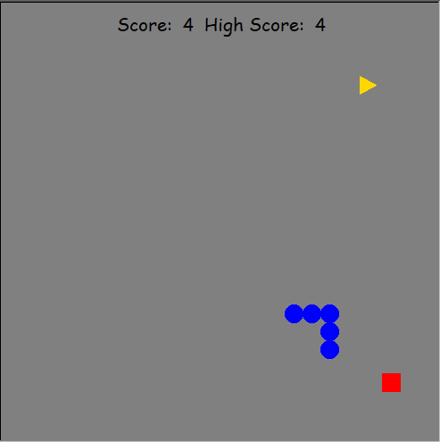

# Worm Game
A simple Worm game built in Python using the turtle module, with score tracking, power-ups, and custom skins.

## Features
- Score and high score tracking
- Speed boost power-up
- Multiple worm skins (press N to cycle)
- Pause functionality

## How to run
1. Make sure Python is installed
2. Run: `python worm_game.py`

## Controls
- W/A/S/D: Move
- Space: Start/restart
- P: Pause
- N: Change skin

## Built with
Python (turtle module)
